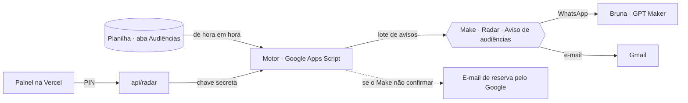

# 📡 Radar de Audiências · Diferencial Soluções

Nenhuma audiência passa despercebida. O Radar confere a planilha de audiências **de hora em hora**, avisa o escritório **3 dias úteis antes** de cada audiência e **de novo na véspera** — pelo WhatsApp da Bruna e por e-mail — e mostra tudo num painel com a marca da Diferencial.



## O que tem aqui

| Pasta | O que é |
|---|---|
| `apps-script/Radar.gs` | **O motor.** Fica dentro da planilha. Verifica as datas, decide quem avisar, monta a mensagem do WhatsApp e o e-mail, grava o histórico e responde ao painel. |
| `apps-script/appsscript.json` | Manifesto do projeto (fuso de São Paulo, App da Web). |
| `apps-script/teste/simulador.js` | Simulador que roda o motor sem Google (`npm test`). |
| `web/` | **O painel** publicado na Vercel: abertura em 3D, radar animado, zona de alerta, agenda, histórico, nova audiência. |
| `web/api/radar.js` | Ponte segura entre o painel e o motor. O navegador nunca vê o endereço do motor nem a chave. |
| `painel-src/loader3d.js` | Fonte da abertura em 3D (three.js). Gera `web/assets/loader3d.js`. |

## Como o radar decide os avisos

* **Zona de alerta** = audiência em até **3 dias úteis** (configurável). Dias úteis pulam sábado, domingo, feriados nacionais e o recesso forense de 20/12 a 06/01 — a lista fica na aba *Configurações* e aceita feriados locais.
* **1º aviso** sai quando a audiência entra na zona. **2º aviso** sai no último dia útil antes dela (ou no próprio dia, se foi cadastrada em cima da hora).
* Nenhum aviso se repete. Se a data mudar (remarcação), o radar avisa de novo para a data nova.
* Os avisos saem entre **08:00 e 19:00**. O que aparecer de madrugada sai na manhã seguinte.
* Um único WhatsApp por verificação, organizado para encaminhar ao grupo do escritório, e um único e-mail com cartões por audiência.
* *Realizada*, *Cancelada* e *Adiada* saem do radar.

## Instalação (uma vez)

### 1. Motor na planilha
> Guia ilustrado com botão para copiar o código: **/instalar** no próprio painel.

1. Abra a planilha **Radar de Audiências — Diferencial Soluções** → **Extensões → Apps Script**.
2. Apague o conteúdo de `Código.gs`, cole todo o `apps-script/Radar.gs` e salve.
3. Escolha a função **`instalarRadar`** → **Executar** → autorize com a conta do escritório.
4. Pronto: aparece o menu **📡 Radar** na planilha e o gatilho de hora em hora fica ativo.

### 2. App da Web (para o painel)
1. No Apps Script: **Implantar → Nova implantação → Tipo: App da Web**.
2. *Executar como:* **Eu** · *Quem pode acessar:* **Qualquer pessoa** → **Implantar**.
3. Copie a URL que termina em `/exec`.

> A URL sozinha não abre nada: toda chamada precisa da **chave de integração** e do **PIN do painel**. Depois de 8 PINs errados, o motor bloqueia por 15 minutos.

### 3. Painel na Vercel
Em **Settings → Environment Variables** do projeto:

| Variável | Valor |
|---|---|
| `RADAR_API_URL` | a URL `/exec` do passo 2 |
| `RADAR_TOKEN` | o valor de **Chave de integração** (aba *Configurações*) |

Faça um novo deploy. Sem essas variáveis o painel abre em **modo demonstração**, com dados fictícios.

### 4. Make (WhatsApp + e-mail)
O cenário **Radar · Aviso de audiências** recebe o lote do motor pelo webhook, confere a chave, responde ao motor e entrega:
* WhatsApp pelo canal da Bruna (GPT Maker → `start-conversation`);
* e-mail pelo Gmail conectado;
* lembrete ao cliente, quando pedido pelo painel ou ligado nas configurações.

O endereço do webhook fica em **Webhook do Make**, na aba *Configurações*. Com o cenário desligado, o motor continua avisando por **e-mail de reserva**.

## Configurações (aba *Configurações*)

| Item | Padrão | Para que serve |
|---|---|---|
| E-mail(s) do escritório | vazio | vazio = e-mail de quem instalou o motor |
| WhatsApp do escritório | — | recebe o resumo pela Bruna |
| 1º aviso — dias antes | 3 | entrada na zona de alerta |
| 2º aviso — dias antes | 1 | véspera (0 desliga) |
| Contar os dias como | Dias úteis | ou Dias corridos |
| Enviar a partir de / até | 08:00 / 19:00 | janela dos envios automáticos |
| Lembrar o cliente pela Bruna | Não | lembrete automático ao cliente no 1º aviso |
| Modo teste | Sim | todo WhatsApp vai só para o número de teste |
| PIN do painel | — | senha do painel (troque quando quiser) |

## Painel

* **Abertura em 3D**: o monograma da Diferencial em metal, girando sobre o radar (cai para uma versão leve em aparelhos sem WebGL ou com “reduzir movimento”).
* **Radar**: centro = hoje, borda = 30 dias; os setores são os dias da semana e cada ponto é uma audiência. A área tracejada é a zona de alerta.
* **Avisar agora**: cartões da zona de alerta com *Lembrar pela Bruna*, *Meu WhatsApp* (abre o seu WhatsApp com a mensagem pronta) e *Cliente avisado*.
* **Agenda** com filtros e busca; **detalhes** com o número CNJ decodificado (tribunal, ramo, região, dígito verificador conferido) e a linha do tempo dos avisos.
* **Nova audiência** grava direto na planilha. Tema claro e escuro. Funciona no celular e pode ser adicionado à tela inicial.

## Desenvolvimento

```bash
npm install            # three.js e esbuild (só para gerar a abertura 3D)
npm test               # simulador do motor
npm run build:loader   # gera web/assets/loader3d.js
npx serve web          # painel local (abre em modo demonstração)
```

## Segurança e LGPD

* A planilha continua privada; o painel só lê pelo motor, com chave + PIN.
* A ponte `api/radar` guarda a URL do motor e a chave em variáveis de ambiente.
* Tudo que entra pelo painel é limpo antes de ir para a planilha (nada de fórmulas injetadas).
* Os dados de demonstração são 100% fictícios.
